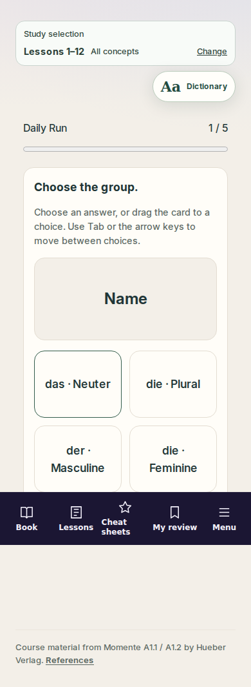
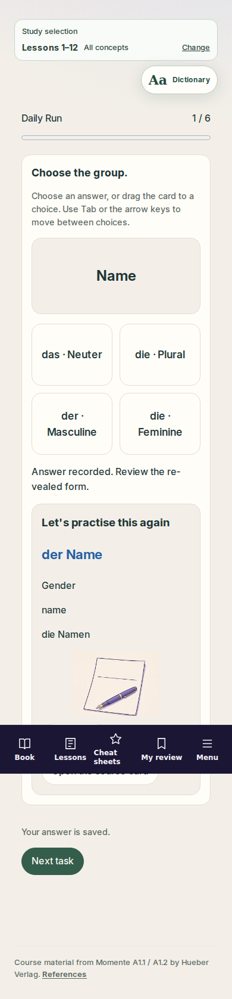
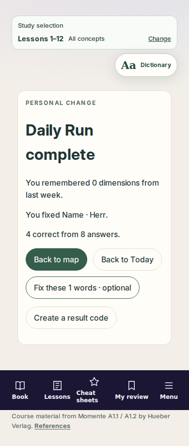

# Wortwerk release evidence

2026-10-22. Validated code commit: `7bfcd83b3fed274e9fa20c578824e4432ee05b60` (local equivalent `d88ff6c2`; tree `6459244d2bec303eafe8530c19096e3f17f62400`). Later commits add evidence/status only. All Lane 2 PRs remain drafts; no merge or deployment.

Validation used an identical clean checkout outside host workspace synchronization, with existing dependencies, the temporary tsx IPC launcher adapter and two Next build workers. Every gate ran sequentially. The original workspace's transient synchronization failures are preserved in the lane status; no assertions were relaxed.

| Command | Result | Raw log |
|---|---|---|
| `npm run check` | 156 files / 1,641 tests; web rerun 131 files / 1,160 tests; types, lint and publication pass | [check.txt](check.txt) |
| `npm run packs:validate` | 40 items / 39 playable templates | [packs.txt](packs.txt) |
| `npm run build:web` | 1,630 pages | [build-web.txt](build-web.txt) |
| `npm run smoke:web-routes` | 50 checks pass | [smoke-web.txt](smoke-web.txt) |
| `npm run gates:pages` | Exact composite passes; preview artifacts absent | [gates-pages.txt](gates-pages.txt) |
| `npm run test:e2e` | 165 tests pass, zero retries | [e2e.txt](e2e.txt) |
| `node tools/audit-attribution.mjs` | Zero failures | [attribution.txt](attribution.txt) |
| `npm run audit:prod` | Fails: one critical Next.js dependency finding; Lane 3 action recorded in status | [audit-prod.txt](audit-prod.txt) |
| Extra Daily Run capture and viewport probe | Completes; reload preserves streak 1 / full-Run goal 1; no Today overflow at 360/390/430/768 px | [visual-check.txt](visual-check.txt) |

The pack remains pending German review and disabled by default. The A1 source diagnostic still has eleven groups on this lane; see [lane status](../../../plans/lanes/lane-2-status.md) for source IDs, the external integration candidate and cross-lane mounts.

The three screenshots show a real run against the local Pages export under `/german-learning-exam`, Chromium 152, a 390 × 844 viewport, reduced motion, and explicit fixture-pack opt-in. Five planned gender tasks gain finite alternate-format comebacks after misses; results show the actual answers. No progress was seeded for the capture. Full-page images include the shell and source credit. The browser suite also covers every mechanic and backup restoration at phone and desktop widths.

